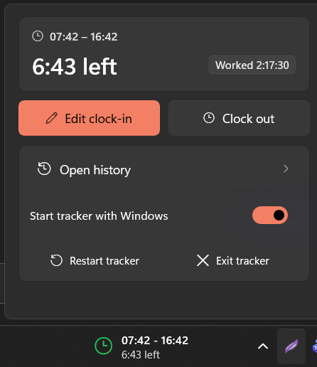

# WorkTimer

WorkTimer is a native Windows 11 taskbar widget and background tracker for daily work hours, remaining time, and overtime.

Powered by [WidBar](https://apps.microsoft.com/detail/9PKLDNM83TP9), WorkTimer lives right in your taskbar next to your tray icons and system clock, offering a clean Windows 11 design with zero intrusive modal popups.



## Features

- **Glanceable Taskbar Widget**: Two-line live display showing your work schedule (e.g. `07:42 – 16:42`) and time remaining (`6:43 left`).
- **Color-Coded Status**:
  - 🔴 **Blinking Red**: Not clocked in yet (*ClockIn Required*).
  - 🟢 **Steady Green**: Clocked in and timer running.
  - 🟠 **Steady Orange**: Working in overtime (>9 hours).
  - ⚪ **Neutral Gray**: Clocked out or weekend.
- **Fast Windows 11 Flyout**:
  - One-click **Clock in** and **Clock out** directly from the taskbar.
  - **Edit clock-in** with an inline time picker flyout.
  - Live **Worked** badge tracking elapsed time to the second.
  - **Open history** to view daily logs in Excel (`WorkTimerHistory.csv`).
  - **Start tracker with Windows** auto-start toggle.
  - Tracker restart and exit actions.
- **Auto-Resumption & Crash Protection**:
  - If Windows restarts or the tracker closes while a workday is active, the widget automatically launches the tracker and synthesizes the live countdown.
  - Handles system sleep/wake and session lock events.

## Prerequisites & Dependencies

1. **Windows 11** (build 22000 or newer).
2. **Windows Developer Mode**: Enabled in `Settings > System > For developers > Developer Mode` (required to register local WinUI 3 AppExtension packages).
3. **[WidBar](https://apps.microsoft.com/detail/9PKLDNM83TP9)**: Install from the Microsoft Store (or GitHub).
4. **[.NET 10 SDK](https://dotnet.microsoft.com/download)**: Required to build both the tracker and the widget.

## Building and Installing

### 1. Build the Tracker Application

```powershell
dotnet publish WorkTimer.csproj -c Release
```

The compiled standalone executable is placed in `dist\WorkTimer.exe`.

### 2. Build and Register the Widget

Run the build and install scripts in PowerShell:

```powershell
powershell -NoProfile -File Widget\Build.ps1
powershell -NoProfile -File Widget\Install.ps1
```

### 3. Add WorkTimer to the Taskbar

1. Open **WidBar** from the Start Menu.
2. In the **Layout** section, click **Refresh Catalog**.
3. Locate **WorkTimer** in the widget list and drag it onto your desired position on the taskbar.
4. Launch `dist\WorkTimer.exe` once (or click **Start tracker** in the widget flyout) to connect the widget.

## Running Tests

To run the regression test suite covering commands, state rollover, status heartbeat, and error handling:

```powershell
dotnet run --project tests/WorkTimer.RegressionTests.csproj -c Release
```
